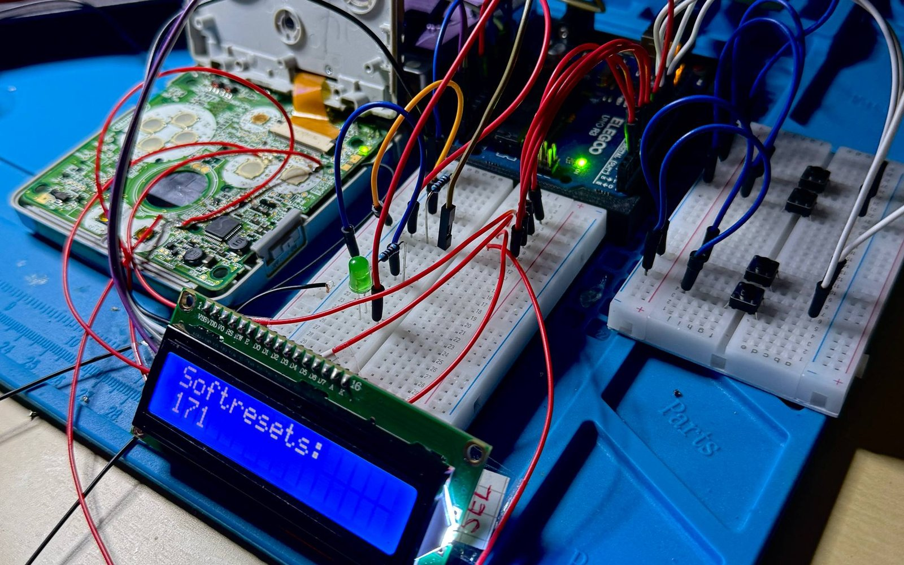
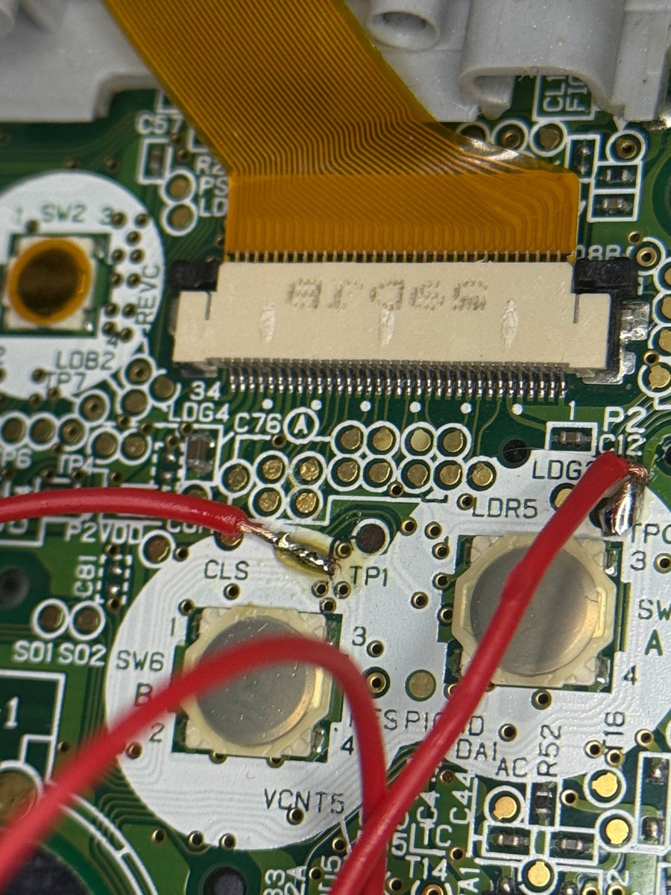
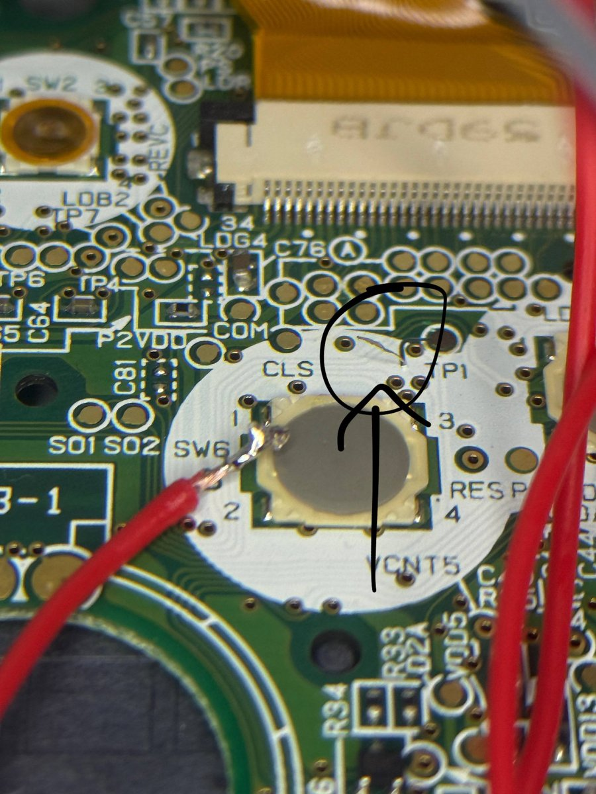

<h1 align="center">GBA Shiny Hunting Rig</h1>

  An Arduino that soft-resets a real Game Boy Advance SP until the starter Pokémon is shiny. 
  It presses the buttons through wires soldered to the mainboard and watches the screen with a light sensor.

   ·
   ·
   ·
  

---

  

## What it is

In the third-generation Pokémon games every Pokémon has a 1 in 8192 chance of
being shiny. The usual way to get a shiny starter is to soft-reset the game
over and over: pick the starter, enter the first battle, look, reset. That is
8192 resets on average, each about 30 seconds long.

This rig does the looking and resetting for me. An Arduino UNO presses the
buttons of a GBA SP through wires soldered to the button pads, runs through
the intro to the first battle and decides from the screen brightness whether
the starter was shiny. If not, it presses A + B + Start + Select (the soft
reset) and starts over. The reset counter is kept in EEPROM, so it survives a
power cut, and an LCD shows it.

The game is Pokémon Ruby, because there the soft resets spread over different
frames much better than in Emerald, so each reset is a real new roll.

Everything runs on original hardware with an original cartridge. No emulator,
no ROM, no save editing.

## How it detects a shiny

A shiny Pokémon plays a sparkle animation when it is sent out. The animation
delays everything after it, including the moment the battle text box appears
at the bottom of the screen.

An LDR is taped over the text box area of the GBA screen and covered with black
tape against room light. The sketch:

1. presses A for the last time to start the battle and notes the time,
2. reads a baseline brightness on `A1`,
3. polls the LDR every 10 ms until the reading is at least 8 ADC steps above
   the baseline twice in a row (the text box is light, the area before it is
   darker),
4. compares the elapsed time with a threshold:
   - **2500 ms or less**: normal send-out, soft reset and try again,
   - **more than 2500 ms**: the sparkle animation held things up, so this is a
     shiny. The rig stops, the LED blinks, the LCD shows `SHINY!!!` and the
     number of resets.

After a hit the four manual buttons keep working, so I can take over and save
the game without touching the GBA.

The threshold depends on the setup. Battery level, how the LDR sits on the screen and the
room light all move this by a few milliseconds, which is why the sensor is
taped in and shaded. The serial monitor (9600 baud) prints every LDR reading
with its timestamp, which is how I found the numbers.

## Wiring

| Arduino UNO | Goes to | Notes |
|---|---|---|
| `D8` | GBA button A pad | held `HIGH`, pulled `LOW` to press |
| `D9` | GBA button B pad | same |
| `D10` | GBA Start pad | same |
| `D11` | GBA Select pad | same |
| `GND` | GBA ground | common ground is required |
| `A1` | LDR voltage divider | LDR to 5 V, fixed resistor to GND |
| `D7` | LED (with resistor) | lights up and blinks on a shiny |
| `D2` `D3` `D4` `D5` | push buttons A, B, Start, Select to GND | manual control, `INPUT_PULLUP` |
| `D12` | push button to GND | resets the counter in EEPROM |
| `A4` `A5` | LCD1602 I2C backpack SDA, SCL | address `0x27` |

The GBA buttons are active low: one side of each button is ground, the other
side is a line that the console pulls up. Pulling that line to ground is the
same as pressing the button. The wires are soldered to that side of each button
pad on the SP mainboard.

  
  

The pads are tiny and the labels on pinout pictures found online are not
always right. I checked every pad with a multimeter before soldering. On the
right is the trace I damaged next to the B button on the first try. I fixed it
by soldering to a test point on the same line instead.

## The sequence

`loop()` runs one attempt per pass:

| Step | What happens |
|---|---|
| wait 8.6 s | console boots after the reset |
| 4 × A, 1.4 s apart | through the title screen and the intro |
| 3 × A | open the bag and choose the starter |
| wait 7 s, then A | the first battle starts |
| measure | wait for the text box on the LDR, see above |

The delays are tuned to my save file, which stands right in front of the bag
with the starters. Another save point or another game needs different values.

## Build it

1. Install the Arduino IDE or `arduino-cli` and the library
   **LiquidCrystal I2C** (by Frank de Brabander). `EEPROM` comes with the core.
2. Open `shiny_hunter/shiny_hunter.ino`, select Arduino UNO, upload.
3. Open the serial monitor at 9600 baud and do a few runs by hand to see where
   your normal send-out time lands, then set `SHINY_THRESHOLD_MS` above it.

## Notes

- The sketch drives the button pins `HIGH` while idle, so they sit at 5 V while
  the GBA runs at 3.3 V. It has worked on my SP, but a gentler way is to keep
  the pins as `INPUT` and only switch them to `OUTPUT` `LOW` for a press, or to
  use transistors or optocouplers between the two boards.
- Code comments and LCD texts are in German.
- A camera with image recognition instead of one LDR would be the next step. It
  would not care about room light and could see the sparkles directly.

## License

MIT, see [LICENSE](LICENSE). Pokémon and Game Boy Advance are trademarks of
their owners. This repo contains no game code, ROMs or game assets.
